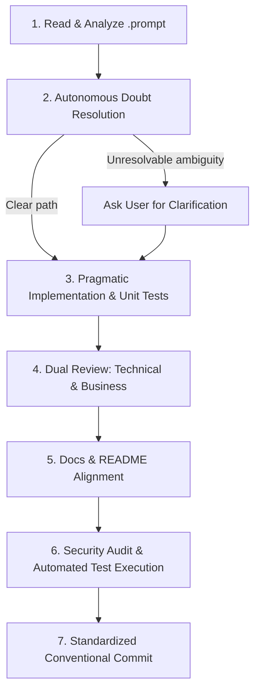

# DELIVER — Activity Execution & Delivery Runbook

This skill establishes the standard operating procedure for implementing and validating engineering activities in the Roubit project from `.prompt` specification files.

---

## Workflow Overview



---

## Step 1: Read & Analyze Activity

1. **Locate and Read the `.prompt` File:**
   - Locate the target activity under `docs/features/<feature-name>/<activity-filename>.prompt`.
   - Read the complete file, paying close attention to:
     - **Objective & Context** and prerequisites.
     - **Technical Scope & Specifications** (target crates, packages, versions).
     - **Data Structures & Signatures** (structs, traits, schemas).
     - **Definition of Done (DoD)** checklist.

2. **Inspect Existing Codebase & Dependencies:**
   - Review related files in `api/crates/` (for backend/CLI) or `frontend/src/` (for UI).
   - Check existing dependencies in `api/Cargo.toml` or `frontend/package.json`.

---

## Step 2: Autonomous Doubt Resolution

1. **Resolve Questions Autonomously:**
   - First, consult project specifications:
     - [Technical Specification](file:///home/filipe/Documents/projects/roubit/docs/00-especificacao-tecnica.md)
     - [Development Plan](file:///home/filipe/Documents/projects/roubit/docs/01-plano-de-desenvolvimento.md)
   - Inspect existing architectural patterns and conventions in the workspace.
2. **When to Ask the User:**
   - **Only** ask the user if there is a fundamental ambiguity, a conflicting business requirement, or a breaking architectural fork that cannot be deduced from documentation.
   - Formulate clear, concise options when asking.

---

## Step 3: Pragmatic Implementation & Testing

1. **Simplicity & Effectiveness First:**
   - Implement the activity in the most straightforward, clean, and maintainable manner.
   - **Avoid overengineering:** No speculative abstractions, unnecessary design patterns, or premature generalized frameworks.
   - Use latest stable library versions already pinned in workspace manifests.
2. **Code Standards:**
   - **Backend (Rust):**
     - Code lives inside `api/` workspace (`api/crates/core`, `api/crates/cli`, `api/crates/server`).
     - Strong typing, domain errors using `thiserror`, avoid unhandled `.unwrap()` in production paths.
     - Memory hygiene: Use `zeroize` where sensitive secrets/keys are touched.
   - **Frontend (Vue 3):**
     - Code lives inside `frontend/src/`.
     - Composition API with `<script setup lang="ts">`, Pinia stores, TailwindCSS utilities.
3. **Unit Tests alongside Implementation:**
   - Write focused unit tests covering core business logic, edge cases, date arithmetic, mathematical algorithms, and state transitions.

---

## Step 4: Dual-Perspective Review

After completing code changes, perform a thorough review from two distinct perspectives:

### 4.1 Technical Review
- **Code Quality:** Does the code follow idiomatic Rust/TypeScript conventions?
- **Error Handling:** Are failure modes handled gracefully with typed errors?
- **Concurrency & Safety:** Are async Tokio tasks, database connections, and locks free of race conditions or deadlocks?
- **Performance:** Does the code respect performance budgets (minimal allocations, zero-copy where appropriate)?

### 4.2 Business & Domain Review
- **Requirement Alignment:** Does the implementation fulfill the specific functional requirement (RF01-RF05) or non-functional requirement (RNF01-RNF04)?
- **Completeness:** Does it check all criteria defined in the activity's **Definition of Done (DoD)**?
- **User Experience:** If CLI or UI, is the interaction intuitive, informative, and frictionless?

---

## Step 5: Documentation & README Alignment

1. **Review Technical Docs:**
   - Check if new configurations, environment variables, or database migrations need documentation in `docs/`.
2. **Update Development Plan:**
   - Check off completed tasks in [docs/01-plano-de-desenvolvimento.md](file:///home/filipe/Documents/projects/roubit/docs/01-plano-de-desenvolvimento.md).
3. **Review `README.md`:**
   - If the activity adds user-facing commands, routes, or setup prerequisites, update [README.md](file:///home/filipe/Documents/projects/roubit/README.md) accordingly.

---

## Step 6: Security Audit & Automated Test Execution

1. **Security Review:**
   - **OWASP Checks:** Input validation (`validator`), SQL parameterization (`sqlx`), XSS/CSRF defenses.
   - **Zero-Knowledge Check:** For Journaling, confirm no plaintext content is sent to or stored on the server.
   - **Memory Scrubbing:** Verify keys and sensitive passphrases implement `ZeroizeOnDrop`.
   - **Secrets Leakage:** Verify no passwords, tokens, or sensitive data are printed to logs (`tracing`).
2. **Execute Automated Tests & Linters:**
   - **Rust (Backend/CLI):**
     ```bash
     cd api
     cargo fmt --all -- --check
     cargo clippy --workspace --all-targets -- -D warnings
     cargo test --workspace
     ```
   - **Frontend (Vue 3):**
     ```bash
     cd frontend
     npm run test
     npm run build
     ```
   - **E2E / Integration Tests:**
     - Run integration tests if applicable for the feature (e.g. `cargo test --test <integration_test_name>`).
   - Fix any failures or compiler warnings before committing.

---

## Step 7: Standardized Conventional Commit

Once all tests pass and documentation is updated, create a clean Git commit using the Conventional Commits specification:

### Commit Format
```text
<type>(<scope>): <imperative description>

[optional body with technical context / rationale]

[optional reference to activity or issue]
```

### Types & Scopes
- **Types:**
  - `feat`: New feature or capability.
  - `fix`: Bug fix.
  - `test`: Adding or updating test suites.
  - `refactor`: Code change that neither fixes a bug nor adds a feature.
  - `docs`: Documentation updates.
  - `perf`: Performance improvements.
  - `chore`: Tooling, CI, dependencies, or configuration updates.
- **Scopes:** `core`, `cli`, `server`, `crypto`, `routine`, `habit`, `okr`, `journal`, `ui`, `infra`.

### Commit Examples
- `feat(routine): implement time block overlap validation engine`
- `feat(crypto): implement argon2id key derivation with zeroize`
- `test(habit): add streak calculation edge case tests`
- `docs(plan): update progress checklist for feature 01`
