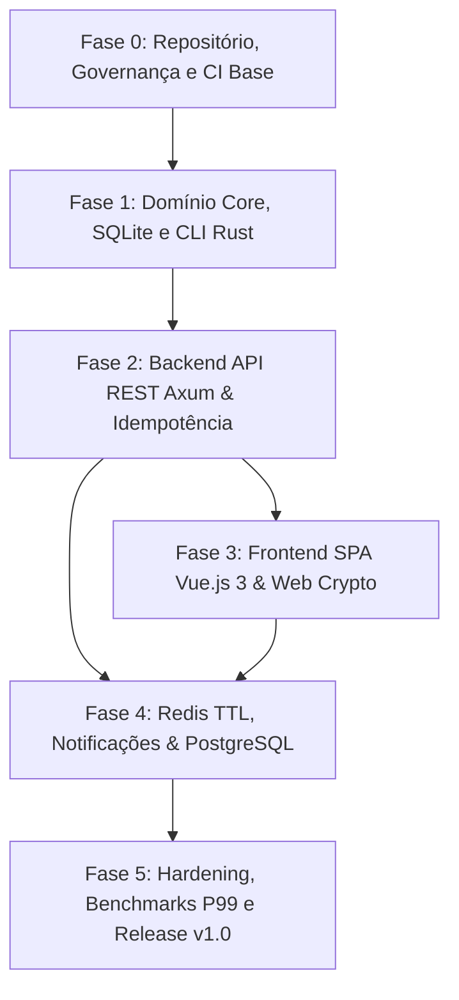

# Roubit — Plano de Desenvolvimento e Roteiro de Atividades

> **Versão:** 1.0.0  
> **Status:** Pronto para Execução  
> **Referência:** [Especificação Técnica](file:///home/filipe/Documents/projects/roubit/docs/00-especificacao-tecnica.md)

---

## 1. Visão Geral e Estratégia de Execução

O desenvolvimento do **Roubit** é estruturado de forma estritamente incremental e orientada a dependências lógicas. O objetivo é garantir que cada fase entregue um componente executável, testado e funcional, evitando retrabalho ou dependências circulares:

---

## 2. Roteiro Cronológico e Detalhado de Atividades

### Fase 0: Inicialização do Repositório, Estrutura de Diretórios e Governança
*Objetivo: Estabelecer as bases do repositório, convenções de código, pipelines iniciais e estrutura modular.*

- [x] **0.1 Estrutura do Monorepo / Diretórios Base**
  - [x] Estabelecer os 3 diretórios raiz do projeto: `docs/`, `frontend/` e `api/`.
  - [x] Configurar Cargo Workspace para o ecossistema Rust dentro de `api/` (`api/Cargo.toml`, `api/crates/core`, `api/crates/cli`, `api/crates/server`).
  - [x] Estruturar diretório do frontend SPA (`frontend/` para Vue 3).
  - [x] Definir `.gitignore`, `.editorconfig` e variáveis de ambiente exemplo (`.env.example`).
- [x] **0.2 Governança de Git & Políticas de Branching**
  - [x] Estabelecer fluxo de branches: `main` (produção/estável), `develop` (integração), `feature/*`.
  - [x] Definir padrão de Conventional Commits (`feat:`, `fix:`, `docs:`, `test:`, `refactor:`, `chore:`).
- [x] **0.3 Configuração Inicial de CI no GitHub Actions**
  - [x] Criar workflow `.github/workflows/rust-ci.yml` (`cargo fmt --check`, `cargo clippy -- -D warnings`, `cargo test`, `cargo audit`).
  - [ ] Criar workflow base `.github/workflows/vue-ci.yml` (lint e type check para o frontend).

---

### Fase 1: Fundação do Domínio, Banco de Dados Local (SQLite) & CLI em Rust
*Objetivo: Implementar as entidades centrais, regras de negócio puras, persistência relacional com SQLite e uma interface CLI funcional e autônoma.*

- [x] **1.1 Modelagem do Banco de Dados e Migrations (SQLx + SQLite WAL)**
  - [x] Configurar conexão SQLite com modo WAL (`PRAGMA journal_mode=WAL`) e `PRAGMA foreign_keys = ON`.
  - [x] Criar migrações SQL para **Rotinas** (`routines`, `time_blocks`, `routine_logs`).
  - [x] Criar migrações SQL para **Hábitos** (`habits`, `habit_logs`, suportando medição binária, numérica e timer).
  - [x] Criar migrações SQL para **OKRs** (`objectives`, `key_results`, vinculação com hábitos).
  - [x] Criar migrações SQL para **Journaling** (`journal_entries` com payload cifrado e metadados abertos).
- [x] **1.2 Módulo de Criptografia em Rust (Field-Level Encryption)**
  - [x] Implementar derivação de chave a partir de senha mestre usando Argon2id.
  - [x] Implementar cifragem e decifragem autenticada usando AES-256-GCM (nonce aleatório + tag de autenticação).
  - [x] Desenvolver suíte de testes de vetores criptográficos e tratamento seguro de memória (zeroize para dados sensíveis).
- [x] **1.3 Camada de Domínio e Casos de Uso (Core Business Logic)**
  - [x] **Gestão de Rotinas (RF01):** Criação, edição e acompanhamento de blocos de tempo; cálculo de aderência do dia.
  - [x] **Rastreamento de Hábitos (RF02):**
    - Lógica de registro para hábitos binários, contadores numéricos (ex: ml, páginas) e timer (minutos).
    - Algoritmo de cálculo de *streaks* (dias consecutivos) e cálculo de percentual de consistência.
  - [x] **Gestão de OKRs (RF03):** Lógica de cálculo de progresso de Resultados-Chave (KRs) com atualização automática a partir dos hábitos vinculados.
  - [x] **Journaling (RF04):** Gravação e leitura de reflexões, garantindo que o texto bruto nunca seja persistido em texto claro.
- [x] **1.4 Interface de Linha de Comando (CLI com Clap)**
  - [x] Implementar subcomando `roubit routine` (listar rotina de hoje, iniciar bloco, finalizar bloco).
  - [x] Implementar subcomando `roubit habit` (listar hábitos, check-in com valor/tempo, status dos streaks).
  - [x] Implementar subcomando `roubit okr` (resumo de objetivos e progresso).
  - [x] Implementar subcomando `roubit journal` (escrever reflexão diária com prompt de senha, listar entradas decifradas).
  - [x] Formatação visual da CLI (tabelas limpas, cores semânticas e barra de progresso no terminal).
- [x] **1.5 Testes Unitários e de Integração da Fase 1**
  - [x] Testes de repositório SQLx com banco de dados em memória/arquivo temporário.
  - [x] Testes de casos de uso (streaks, quebra de sequência, time blocks sobrepostos).
  - [x] Validação do pipeline no GitHub Actions.

---

### Fase 2: Backend HTTP REST, Autenticação & Idempotência (Axum + Tokio)
*Objetivo: Expor os casos de uso do domínio através de uma API HTTP assíncrona, robusta, protegida e com garantia de idempotência.*

- [ ] **2.1 Fundação da API Web com Axum**
  - [x] Configuração do servidor HTTP Tokio/Axum, graceful shutdown e injeção de estado (`AppState`).
  - [x] Middleware estruturado de Tracing/Logs (`tracing`, `tracing-subscriber`).
  - [x] Middleware global de tratamento de erros com respostas JSON padronizadas (RFC 7807 Problem Details).
  - [ ] Configuração de CORS restrito e headers de segurança (OWASP: HSTS, Content-Security-Policy, X-Frame-Options).
- [ ] **2.2 Autenticação, Sessão e Criptografia de Usuário**
  - [ ] Tabela e endpoints de Usuários (`/api/v1/auth/register`, `/api/v1/auth/login`, `/api/v1/auth/me`).
  - [ ] Hash de senha via Argon2id.
  - [ ] Emissão e validação de tokens JWT / Cookies seguros (`HttpOnly`, `Secure`, `SameSite=Strict`).
  - [ ] Extractor personalizado do Axum para autenticação e injeção do usuário autenticado no contexto dos handlers.
- [ ] **2.3 Middleware de Idempotência Transacional (RF05)**
  - [ ] Criação do interceptor de requisição para leitura do header `Idempotency-Key`.
  - [ ] Tabela de armazenamento de requisições idempotentes (hash da requisição, status, payload de resposta).
  - [ ] Garantia de bloqueio para requisições concorrentes idênticas e retorno de resposta cacheada para reenvios.
- [ ] **2.4 Endpoints da API REST (Rotas e Controladores)**
  - [ ] **Rotinas:** `GET /api/v1/routines`, `POST /api/v1/routines`, `POST /api/v1/routines/blocks/:id/complete`.
  - [ ] **Hábitos:** `GET /api/v1/habits`, `POST /api/v1/habits`, `POST /api/v1/habits/:id/checkin` (com suporte a Idempotency-Key).
  - [ ] **OKRs:** `GET /api/v1/objectives`, `POST /api/v1/objectives`, `POST /api/v1/key-results`.
  - [ ] **Journaling:** `GET /api/v1/journal`, `POST /api/v1/journal` (recebimento exclusivo de payload cifrado e metadados abertos).
- [ ] **2.5 Adaptação da CLI para Modo Híbrido**
  - [ ] Permitir que a CLI opere conectando-se à API HTTP REST via flag/configuração (`--remote` / `ROUBIT_API_URL`), além do modo local SQLite.
- [ ] **2.6 Validação de Segurança & CI da Fase 2**
  - [ ] Testes E2E dos endpoints HTTP REST.
  - [ ] Testes de concorrência e teste de validação do header de idempotência.
  - [ ] Integração de análise estática de segurança (SAST) com `cargo audit` no pipeline.

---

### Fase 3: Frontend SPA Reativo em Vue.js 3
*Objetivo: Construir interface gráfica reativa, moderna, minimalista e com criptografia no cliente para o Journaling.*

- [ ] **3.1 Setup do Frontend com Vue 3 & Vite**
  - [ ] Inicialização do projeto Vue 3 (Composition API, TypeScript, Vite, Vue Router, Pinia).
  - [ ] Integração do TailwindCSS com design system minimalista, tipografia moderna e suporte a Dark Mode.
  - [ ] Configuração do pipeline `.github/workflows/vue-ci.yml` (linting, checagem de tipos, build).
- [ ] **3.2 Camada de Serviços, HTTP e Gerenciamento de Estado**
  - [ ] Cliente HTTP (Axios / Fetch) configurado com interceptors (injeção de credenciais e geração automática de `Idempotency-Key` UUIDv4 para mutações).
  - [ ] Stores Pinia: `useAuthStore`, `useRoutineStore`, `useHabitStore`, `useOkrStore`, `useJournalStore`.
- [ ] **3.3 Módulo de Criptografia no Cliente (Web Crypto API / Argon2)**
  - [ ] Implementar fluxo de desbloqueio de chave: usuário insere senha mestre/passphrase no navegador.
  - [ ] Derivação de chave AES-256-GCM via Web Crypto API / WASM.
  - [ ] Cifragem de reflexões do Journaling antes do envio HTTP e decifragem local após o recebimento.
  - [ ] Política de retenção de chave exclusivamente em memória de sessão (sem persistir senha ou chave privada em texto claro no LocalStorage).
- [ ] **3.4 Telas e Componentes da Interface**
  - [ ] **Painel de Autenticação:** Login, Registro e Modal de Desbloqueio do Diário.
  - [ ] **Dashboard Unificado Diário:**
    - Visualização da linha do tempo dos Blocos de Rotina com status em tempo real.
    - Lista de Hábitos do dia com ações de check-in rápido em um clique (ou input numérico/timer).
    - Barra de progresso diário consolidada.
  - [ ] **Módulo Habit Tracker & Streaks:**
    - Visualização gráfica de sequências (*streaks*), calendário estilo mapa de calor (estilo GitHub contributions).
  - [ ] **Módulo de OKRs:**
    - Árvore de visualização de Objetivos e Resultados-Chave com medidores de progresso interativos.
  - [ ] **Módulo de Journaling Criptografado:**
    - Editor minimalista com foco em escrita reflexiva (intenções do dia e retrospectiva noturna).
    - Indicador visual de criptografia ativa (cadeado fechado e status da chave).
- [ ] **3.5 Testes de Frontend e Acessibilidade**
  - [ ] Testes unitários de componentes e stores com Vitest.
  - [ ] Validação de responsividade (Desktop e Mobile) e ergonomia visual.

---

### Fase 4: Redis TTL, Notificações e Transição para PostgreSQL
*Objetivo: Integrar cache distribuído, agendamento de lembretes em tempo real por TTL do Redis, suporte a PostgreSQL e orquestração Docker.*

- [ ] **4.1 Integração com Redis**
  - [ ] Configuração do cliente assíncrono Redis no backend Rust (`redis-rs` / `deadpool-redis`).
  - [ ] Migração do armazenamento de idempotência e locks distribuídos para o Redis com tempo de expiração configurável.
  - [ ] Implementação de agendamento de lembretes e alertas de início de blocos de rotina utilizando Redis Keyspace Notifications e expiração por TTL.
- [ ] **4.2 Mecanismo de Notificações e Lembretes**
  - [ ] Serviço de background worker no Tokio para consumir eventos de disparo do Redis.
  - [ ] Notificações no frontend via Server-Sent Events (SSE) ou Web Push / notificações no desktop CLI.
- [ ] **4.3 Suporte Dual de Banco de Dados: SQLite & PostgreSQL**
  - [ ] Parametrização do SQLx para compatibilidade de dialetos SQL entre SQLite (desenvolvimento/CLI local) e PostgreSQL (servidor corporativo).
  - [ ] Migrations SQL versionadas compatíveis com PostgreSQL.
  - [ ] Script utilitário para migração e transição de dados do SQLite para o PostgreSQL.
- [ ] **4.4 Orquestração com Docker Compose**
  - [ ] `Dockerfile` multi-stage otimizado para o backend Rust (binário mínimo e sem runtime dependencies).
  - [ ] `Dockerfile` multi-stage para o frontend Vue 3 (build estático servido via Nginx).
  - [ ] `docker-compose.yml` completo integrando: API Rust + Frontend SPA + PostgreSQL + Redis.
  - [ ] Healthchecks automáticos e inicialização de todo o ecossistema com um único comando (`docker compose up -d`).

---

### Fase 5: Homologação, Hardening e Release v1.0
*Objetivo: Assegurar métricas de performance extremas, segurança estrita e disponibilização da versão 1.0.*

- [ ] **5.1 Benchmarks de Desempenho e Consumo (Validação de RNF04)**
  - [ ] Testes de carga na API (k6 / wrk / vegeta) para validar latência **P99 < 10ms** em condições normais.
  - [ ] Perfilamento de consumo de memória do processo Rust para garantir footprint **< 25MB RAM**.
- [ ] **5.2 Auditoria de Segurança OWASP (Validação de RNF03)**
  - [ ] Validação estrita de cookies (`HttpOnly`, `Secure`, `SameSite=Strict`).
  - [ ] Verificação contra SQL Injection (garantia de compile-time verification do SQLx).
  - [ ] Auditoria de dependências com `cargo audit` e `npm audit`.
- [ ] **5.3 Documentação Final e Guias de Operação**
  - [ ] Especificação OpenAPI / Swagger para os endpoints REST.
  - [ ] `README.md` do repositório com guia rápido de início (Quickstart local e via Docker).
  - [ ] Manual da CLI e guia do usuário.
- [ ] **5.4 Publicação da Release v1.0**
  - [ ] Tagging de versão no Git (`v1.0.0`).
  - [ ] Geração de changelog e release assets no GitHub.

---

## 3. Matriz de Rastreabilidade (Requisitos vs. Fases)

| Código | Descrição do Requisito | Fase Responsável | Tarefas Associadas |
| :--- | :--- | :---: | :--- |
| **RF01** | Gestão de Rotinas (Time Blocks) | Fase 1, 2, 3 | 1.1, 1.3, 1.4, 2.4, 3.4 |
| **RF02** | Rastreamento de Hábitos (Habit Tracker & Streaks) | Fase 1, 2, 3 | 1.1, 1.3, 1.4, 2.4, 3.4 |
| **RF03** | Gestão de Objetivos e Metas (OKRs) | Fase 1, 2, 3 | 1.1, 1.3, 1.4, 2.4, 3.4 |
| **RF04** | Journaling Criptografado (AES-256-GCM + Argon2id) | Fase 1, 2, 3 | 1.2, 1.3, 1.4, 2.4, 3.3, 3.4 |
| **RF05** | Idempotência Transacional (Idempotency-Key) | Fase 2, 4 | 2.3, 2.4, 3.2, 4.1 |
| **RNF01** | Criptografia Seletiva no Cliente | Fase 1, 3 | 1.2, 3.3, 3.4 |
| **RNF02** | Resiliência e Memory Safety (Rust) | Todas as Fases | 0.1, 0.3, 1.3, 2.1 |
| **RNF03** | Hardening OWASP (Cookies, CSP, SQLx) | Fase 2, 5 | 2.1, 2.2, 5.2 |
| **RNF04** | Desempenho (P99 < 10ms, RAM < 25MB) | Fase 1, 2, 5 | 1.3, 2.1, 5.1 |

---

## 4. Definição de Pronto (Definition of Done - DoD)

Para que qualquer atividade ou fase seja dada como concluída, os seguintes critérios devem ser atendidos:
1. **Código Testado:** Testes unitários e de integração implementados com cobertura adequada.
2. **CI Verde:** Todos os checks de linting (`cargo clippy`, `eslint`), formatação (`cargo fmt`) e auditoria de segurança passando no GitHub Actions sem advertências.
3. **Idempotência e Segurança:** Mutações críticas suportam cabeçalho de idempotência e dados sensíveis de Journaling nunca trafegam ou repousam em texto claro.
4. **Documentação Atualizada:** Documentação correspondente (código, OpenAPI ou guias na pasta `docs/`) atualizada.
