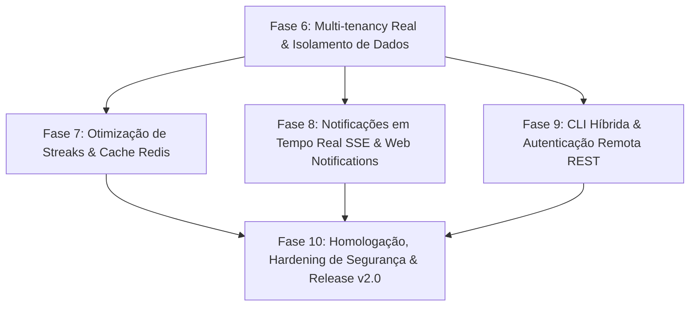

# Roubit — Plano de Desenvolvimento e Roteiro de Atividades (v2.0)

> **Versão:** 2.0.0  
> **Status:** Pronto para Execução  
> **Referência:** [Especificação Técnica](00-especificacao-tecnica.md) | [Plano v1.0.0](01-plano-de-desenvolvimento.md) | [Painel de Atividades](02-status-atividades.md)

---

## 1. Visão Geral e Estratégia de Execução

Após a entrega integral da versão 1.0.0 do **Roubit** (domínio central, CLI autônoma, API REST Axum com idempotência, frontend SPA Vue 3 com criptografia seletiva no cliente e infraestrutura dual SQLite/PostgreSQL com Redis), este plano de desenvolvimento estabelece o roteiro de engenharia para a **Versão 2.0 (Evolução & Hardening)**.

O objetivo da v2.0 é transformar a arquitetura local em um ecossistema **verdadeiramente multi-tenant, reativo em tempo real, de altíssima performance analítica e acessível remotamente via CLI**:

---

## 2. Roteiro Cronológico e Detalhado de Atividades

### Fase 6: Multi-tenancy Real & Isolamento Estrito de Dados por Usuário
*Objetivo: Migrar a persistência global para suporte nativo a múltiplos usuários, garantindo isolamento criptográfico e relacional absoluto entre contas.*

- [x] **6.1 Migração de Banco de Dados Multi-tenant (SQLite & PostgreSQL)**
  - [x] Criar migration `0007_add_user_id_multi_tenancy.sql` adicionando coluna `user_id TEXT NOT NULL REFERENCES users(id) ON DELETE CASCADE` nas tabelas `habits`, `routines`, `objectives` e `journal_entries`.
  - [x] Criar índices compostos para alta performance de consulta por usuário:
    - `idx_habits_user_archived ON habits(user_id, is_archived)`
    - `idx_routines_user_active ON routines(user_id, is_active)`
    - `idx_objectives_user_quarter ON objectives(user_id, quarter)`
    - `idx_journal_user_date ON journal_entries(user_id, entry_date DESC)`
  - [x] Garantir compatibilidade com o dialeto PostgreSQL em `api/crates/core/migrations_pg/`.
- [ ] **6.2 Scoping de Usuário na Camada de Repositórios (`roubit-core`)**
  - [ ] Atualizar as traits de repositório (`HabitRepository`, `RoutineRepository`, `OkrRepository`, `JournalRepository`) para exigir `user_id: Uuid` em todas as operações de leitura, criação e exclusão.
  - [ ] Modificar implementações `SqliteHabitRepository`, `SqliteRoutineRepository`, `SqliteOkrRepository` e `SqliteJournalRepository` garantindo que queries `SELECT`, `UPDATE` e `DELETE` incluam cláusula `WHERE user_id = ?`.
  - [ ] Assegurar integridade relacional ao vincular Key Results a Hábitos apenas se pertencerem ao mesmo `user_id`.
- [ ] **6.3 Extração e Injeção do Usuário Autenticado nos Controladores Axum (`roubit-server`)**
  - [ ] Conectar o extractor `user: AuthenticatedUser` em todos os handlers das rotas protegidas em `api/crates/server/src/controllers/`.
  - [ ] Propagar `user.id` para serviços de aplicação (`OkrSyncService`, `JournalService`).
  - [ ] Retornar `404 Not Found` (ou `403 Forbidden`) em tentativas de acesso a IDs pertencentes a outros usuários (prevenção contra IDOR).
- [ ] **6.4 Testes de Isolamento Multi-tenant & Validação de Segurança**
  - [ ] Testes de integração em `api/tests/` simulando múltiplos usuários simultâneos (Usuário A e Usuário B).
  - [ ] Garantir que o Usuário A não consiga listar, alterar, dar check-in ou deletar hábitos, rotinas, OKRs ou entradas de diário do Usuário B.

---

### Fase 7: Otimização de Performance e Cache dos Streaks de Hábitos
*Objetivo: Eliminar o gargalo de consultas N+1 e leituras de 365 dias de logs a cada check-in, mantendo a latência P99 < 10ms à medida que o histórico de logs cresce.*

- [ ] **7.1 Desnormalização do Schema de Hábitos (Streaks)**
  - [ ] Criar migration `0008_habit_streak_denormalization.sql` adicionando colunas `current_streak INTEGER NOT NULL DEFAULT 0` e `longest_streak INTEGER NOT NULL DEFAULT 0` na tabela `habits`.
  - [ ] Criar script de backfill/migração para calcular e preencher os streaks históricos existentes.
- [ ] **7.2 Algoritmo de Atualização Incremental Atômica de Streak**
  - [ ] Refatorar `StreakCalculator` para suportar modo incremental `update_streak(current, last_date, checkin_date, frequency_days)`.
  - [ ] Atualizar `record_check_in` no repositório para atualizar atomicamente os contadores de streak na tabela `habits` dentro da mesma transação SQL.
  - [ ] Eliminar a consulta `get_logs_for_habit(habit_id, today - 365 days, today)` dos endpoints críticos de check-in e listagem.
- [ ] **7.3 Camada de Cache em Redis para Resumos de Hábitos e Aderência**
  - [ ] Implementar cache no Redis para o sumário diário de hábitos (`roubit:cache:user:{user_id}:habits:summary`) com TTL curto (5 minutos).
  - [ ] Invalidação ativa e atômica da chave de cache no momento da realização de check-in (`POST /api/v1/habits/:id/checkin`).
- [ ] **7.4 Benchmarks de Regressão e Validação de Throughput**
  - [ ] Atualizar suíte de testes de carga em `api/tests/load_p99_benchmark.rs`.
  - [ ] Comprovar redução no consumo de CPU e tempo de resposta em check-in com base histórica de 10.000 logs por usuário.

---

### Fase 8: Notificações em Tempo Real no Frontend (SSE & Web Notifications)
*Objetivo: Fechar o ciclo do módulo de Time Blocking tornando o Roubit proativo com alertas em tempo real no navegador via Server-Sent Events e Web Notifications API.*

- [ ] **8.1 Store Pinia de Notificações em Tempo Real (`useNotificationStore`)**
  - [ ] Implementar cliente SSE em `frontend/src/stores/notification.ts` consumindo `/api/v1/notifications/stream`.
  - [ ] Lógica de reconexão resiliente com backoff exponencial e recuperação automática de sessão em caso de queda de rede.
  - [ ] Gerenciamento de estado de conexão (`connecting`, `connected`, `disconnected`).
- [ ] **8.2 Integração com a Web Notifications API do Navegador**
  - [ ] Adicionar pedido explícito de permissão de notificações do sistema operacional (`Notification.requestPermission()`).
  - [ ] Exibir notificações nativas do sistema com título, ícone e mensagem ao receber eventos de início/fim de blocos de rotina ou lembretes de hábitos agendados.
  - [ ] Síntese de aviso sonoro sutil via Web Audio API integrada (sem carregar arquivos de áudio externos).
- [ ] **8.3 Componente Visual de Toasts & Central de Notificações na UI**
  - [ ] Criar componente `NotificationToast.vue` com animação sutil no canto superior direito seguindo o design system escuro e minimalista.
  - [ ] Suporte a ações rápidas no toast (ex: "Iniciar Foco no Bloco" ou "Check-in Rápido").
- [ ] **8.4 Testes Vitest da Camada de Notificações**
  - [ ] Mock de `EventSource` no Vitest testando recepção de payloads de notificação, fallbacks e tratamento de erros.

---

### Fase 9: Modo Híbrido na CLI Rust (`roubit --remote` / `ROUBIT_API_URL`)
*Objetivo: Permitir que desenvolvedores utilizem a CLI localmente ou apontando para uma API REST remota com segurança e controle de sessão.*

- [ ] **9.1 Abstração de Transporte e Cliente HTTP na CLI (`RoubitClient`)**
  - [ ] Definir a trait assíncrona `RoubitClient` desacoplando a interface Clap da camada de persistência.
  - [ ] Implementar `LocalClient` (chamadas diretas ao SQLite via `roubit-core`) e `HttpClient` (chamadas REST assíncronas com `reqwest`).
  - [ ] Suporte à flag global `--remote <URL>` e à variável de ambiente `ROUBIT_API_URL`.
- [ ] **9.2 Gerenciamento Seguro de Credenciais da CLI (`~/.roubit/`)**
  - [ ] Implementar subcomando `roubit auth login` (solicitação de e-mail e senha com máscara de terminal).
  - [ ] Armazenar o token JWT de acesso em `~/.roubit/credentials.json` com permissões restritas de arquivo Unix (`0600`).
  - [ ] Subcomando `roubit auth logout` e `roubit auth status`.
- [ ] **9.3 Injeção Automática de Headers de Idempotência e Autorização**
  - [ ] Injetar cabeçalho `Authorization: Bearer <token>` em todas as requisições autenticadas da CLI.
  - [ ] Gerar e transmitir cabeçalho `Idempotency-Key` com UUIDv4 em todos os comandos de mutação (`habit checkin`, `routine complete`, `journal write`).
- [ ] **9.4 Testes de Integração e E2E da CLI Remota**
  - [ ] Testes automatizados executando binário `roubit-cli` contra um servidor Axum in-process testando login, check-in e saída formatada no terminal.

---

### Fase 10: Homologação, Hardening de Segurança & Release v2.0
*Objetivo: Assegurar estabilidade total, auditoria de segurança estrita e publicação da versão 2.0.*

- [ ] **10.1 Auditoria de Segurança Multi-tenant & OWASP**
  - [ ] Varredura estrita contra vazamento de memória com `zeroize` em novos fluxos de autenticação na CLI.
  - [ ] Auditoria de endpoints para garantir ausência total de vulnerabilidades IDOR.
- [ ] **10.2 Bateria Completa de Testes Automatizados**
  - [ ] Backend: `cargo fmt --check`, `cargo clippy --all-targets` (0 warnings), `cargo test` (unitários + integração).
  - [ ] Frontend: `npm test` (Vitest com 100% de aprovação), `npm run build` (`vue-tsc -b && vite build`).
- [ ] **10.3 Atualização Documental e Guias de Operação**
  - [ ] Atualização do [README.md](file:///home/filipe/Documents/projects/roubit/README.md) com novos comandos da CLI remota e variáveis de ambiente.
  - [ ] Atualização do [02-status-atividades.md](file:///home/filipe/Documents/projects/roubit/docs/02-status-atividades.md) e [features/README.md](file:///home/filipe/Documents/projects/roubit/docs/features/README.md).
- [ ] **10.4 Publicação da Release v2.0**
  - [ ] Geração de tag Git `v2.0.0` e compilação de binários de release.

---

## 3. Matriz de Rastreabilidade (Requisitos vs. Fases)

| Código | Descrição do Requisito | Fase Responsável | Tarefas Associadas |
| :--- | :--- | :---: | :--- |
| **RF01** | Gestão de Rotinas (Time Blocks & Notificações) | Fase 6, 8, 9 | 6.1, 6.2, 6.3, 8.2, 9.3 |
| **RF02** | Rastreamento de Hábitos (Streaks Otimizados & CLI) | Fase 6, 7, 9 | 6.1, 6.2, 6.3, 7.1, 7.2, 7.3, 9.3 |
| **RF03** | Gestão de Objetivos e Metas (OKRs Multi-tenant) | Fase 6, 9 | 6.1, 6.2, 6.3, 9.3 |
| **RF04** | Journaling Criptografado (Isolamento por Usuário) | Fase 6, 9 | 6.1, 6.2, 6.3, 9.3 |
| **RF05** | Idempotência Transacional na CLI Remota | Fase 9 | 9.1, 9.3 |
| **RNF01** | Criptografia Seletiva no Cliente & Multi-tenancy | Fase 6 | 6.1, 6.2, 6.4, 10.1 |
| **RNF02** | Resiliência, Memory Safety & Permissões Unix | Fase 6, 9, 10 | 6.2, 9.2, 10.1 |
| **RNF03** | Hardening OWASP & Prevenção IDOR | Fase 6, 10 | 6.3, 6.4, 10.1 |
| **RNF04** | Desempenho Extremo (P99 < 10ms com Histórico Alto) | Fase 7, 10 | 7.1, 7.2, 7.3, 7.4 |

---

## 4. Definição de Pronto (Definition of Done - DoD)

Para que qualquer atividade da versão 2.0 seja considerada concluída, os seguintes critérios rigorosos devem ser atendidos:

1. **Isolamento Absoluto:** Nenhuma operação de banco de dados ou rota HTTP pode expor ou modificar registros de outro usuário.
2. **Código Testado:** Testes unitários e de integração implementados com cobertura abrangente de casos de sucesso e cenários de erro/tentativa de intrusão.
3. **CI 100% Verde:** Todos os checks de linting (`cargo clippy -- -D warnings`, `eslint`), formatação (`cargo fmt`) e auditoria de segurança passando no GitHub Actions sem advertências.
4. **Performance Preservada:** Latência P99 das operações de check-in e listagem mantida abaixo de 10ms mesmo com histórico acumulado.
5. **Documentação e Prompts Sincronizados:** Documentos da pasta `docs/` e arquivos `.prompt` de cada atividade atualizados com as decisões de engenharia.
