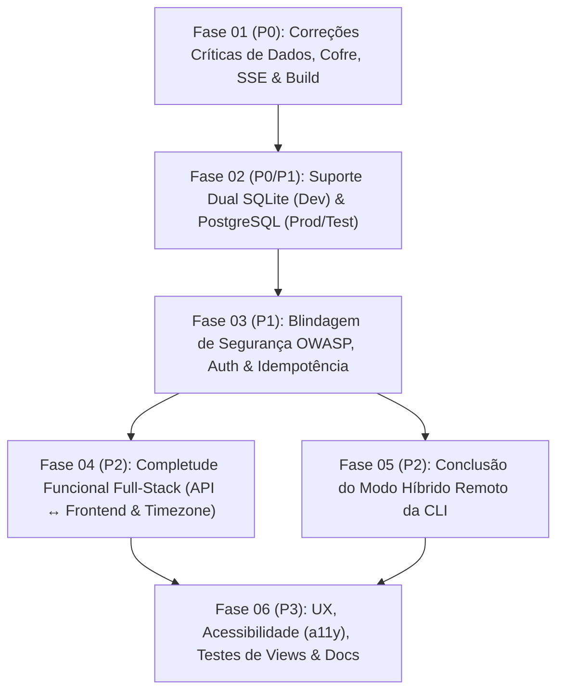

# Roubit — Plano de Melhorias, Correções e Estabilização (v3.0)

> **Versão:** 3.0.0  
> **Status:** Pronto para Execução  
> **Referência:** [Especificação Técnica](00-especificacao-tecnica.md) | [Plano v1.0](01-plano-de-desenvolvimento.md) | [Painel de Atividades](02-status-atividades.md) | [Plano v2.0](03-plano-de-desenvolvimento-v2.md) | [Índice de Melhorias](improvements/README.md)

---

## 1. Visão Geral e Estratégia de Execução

Após uma auditoria profunda linha a linha de todo o código-fonte (`api/crates/core`, `api/crates/server`, `api/crates/cli` e `frontend/`), este plano organiza **todas as correções críticas, suporte dual SQLite/PostgreSQL, blindagem de segurança OWASP, integrações faltantes Full-Stack/CLI e refinamentos de UX/Acessibilidade** em **6 Fases ordenadas estritamente por criticidade (`P0` a `P3`)**.

Todas as especificações executáveis de atividades (`.prompt`) estão isoladas na pasta [`docs/improvements/`](file:///home/filipe/Documents/projects/roubit/docs/improvements/README.md) para preservar o histórico original em [`docs/features/`](file:///home/filipe/Documents/projects/roubit/docs/features/README.md).

### Diretrizes Arquiteturais Obrigatórias deste Ciclo
1. **Banco de Dados por Ambiente:**
   - **Desenvolvimento Local e CLI Local:** SQLite Embedded em modo WAL (`DATABASE_URL=sqlite://roubit.db?mode=rwc`).
   - **Produção (`docker-compose.yml`) e Testes de Servidor:** PostgreSQL 16 (`DATABASE_URL=postgres://...`) + Redis 7.
2. **Cofre Zero-Knowledge do Diário (Melhor Custo-Benefício):**
   - Derivação sob demanda com cache de `CryptoKey` por `salt` em memória RAM (`Map<string, CryptoKey>`) em `vaultStore` + reutilização do `salt` do usuário para novas entradas (com `nonce` aleatório único de 96 bits por entrada), garantindo decifragem entre sessões com apenas 1 execução de Argon2id por sessão e limpeza automática da RAM no auto-lock/logout.
3. **Sincronização Contínua do `README.md`:**
   - Qualquer atividade que altere variáveis de ambiente, portas, dependências, comandos de build ou instruções para subir a aplicação deve atualizar imediatamente o [`README.md`](file:///home/filipe/Documents/projects/roubit/README.md) (e `.env.example`).

---

## 2. Roteiro Priorizado de Fases e Atividades (`docs/improvements/`)

### 🔴 Fase 01: Correções Críticas de Dados, Cofre, Notificações & Build (`P0 — Bloqueadores Críticos`)
*Objetivo: Eliminar vazamentos de lock no banco SQLite, perda de acesso às notas criptografadas entre sessões, falha de build TypeScript/Docker e quebra do worker de notificações em tempo real.*

- [x] **01.1 Restauração do Build TypeScript/Docker & Utilitários Tailwind** ([activity-01-frontend-build-tsconfig-and-tailwind-fixes.prompt](file:///home/filipe/Documents/projects/roubit/docs/improvements/01-critical-data-and-vault-fixes/activity-01-frontend-build-tsconfig-and-tailwind-fixes.prompt))
  - [x] Criar `frontend/tsconfig.app.json` para restaurar `npm run build` (`vue-tsc -b && vite build`) e o build da imagem Docker `web`.
  - [x] Declarar `fontFamily.outfit`, `fontFamily.mono` e animações `animate-fade-in` e `animate-bounce-short` em `frontend/tailwind.config.js`.
  - [x] Corrigir classe inválida `py-0.2` para `py-0.5` em `StreakBadge.vue` e atualizar instruções de build no `README.md`.
- [x] **01.2 Segurança Transacional SQLite & Decaimento Real de Streaks** ([activity-02-sqlite-transaction-safety-and-streak-decay.prompt](file:///home/filipe/Documents/projects/roubit/docs/improvements/01-critical-data-and-vault-fixes/activity-02-sqlite-transaction-safety-and-streak-decay.prompt))
  - [x] Substituir `pool.acquire()` + `BEGIN IMMEDIATE` manual em `SqliteHabitRepository::record_check_in` por `self.pool.begin().await?` (RAII Drop rollback guard, eliminando `SQLITE_BUSY` em cancelamentos/timeouts).
  - [x] Validar e decair `current_streak` para `0` em `list_active_habits_with_streaks` quando dias programados foram perdidos desde o último check-in.
  - [x] Recalcular streaks corretamente quando um check-in concluído é sobrescrito com valor incompleto ou quando check-ins retroativos (datas passadas) são registrados.
  - [x] Corrigir denominador de `HabitAnalyticsService::generate_summary` para iniciar em `max(start_date, habit.created_at.date_naive())`.
- [x] **01.3 Derivação Determinística por Salt no Cofre do Diário, Auto-Lock & AAD** ([activity-03-journal-vault-salt-derivation-and-autolock.prompt](file:///home/filipe/Documents/projects/roubit/docs/improvements/01-critical-data-and-vault-fixes/activity-03-journal-vault-salt-derivation-and-autolock.prompt))
  - [x] Implementar `getKeyForSalt(saltBase64)` com cache em RAM (`Map<string, CryptoKey>`) em `frontend/src/stores/vault.ts` e integrar em `JournalView.vue`, permitindo decifrar entradas de sessões anteriores e reutilizar o `salt` do usuário em novas entradas.
  - [x] Acionar `vaultStore.resetInactivityTimer()` ao digitar/navegar no Diário e limpar `plaintextReflection`, `moodScore` e `tags` via `watch(() => vaultStore.isUnlocked)` quando ocorrer auto-lock.
  - [x] Vincular AAD (`user_id`, `entry_id`, `entry_date`) no AES-256-GCM do `JournalService` (backend/CLI) e adicionar constraint `UNIQUE(user_id, entry_date)` em `journal_entries`.
- [x] **01.4 Correção SQL do Reminder Worker, Agendamento Redis, Timeout SSE & Nginx** ([activity-04-reminder-worker-sql-sse-and-nginx-fixes.prompt](file:///home/filipe/Documents/projects/roubit/docs/improvements/01-critical-data-and-vault-fixes/activity-04-reminder-worker-sql-sse-and-nginx-fixes.prompt))
  - [x] Corrigir queries SQL em `reminder_worker.rs` (`tb.title` -> `tb.name`, bind de `Uuid` em vez de `&str`, e filtro `AND user_id = ?`).
  - [x] Integrar `ReminderScheduler` nos controllers de rotinas e hábitos ao criar/excluir blocos ou hábitos.
  - [x] Separar a rota SSE `GET /api/v1/notifications/stream` do `TimeoutLayer` de 30s em `server.rs` e adicionar `proxy_buffering off; proxy_cache off; proxy_read_timeout 86400s;` em `frontend/nginx.conf`.

---

### 🔴 Fase 02: Suporte Dual de Banco de Dados — SQLite (Dev Local) & PostgreSQL (Prod / Testes) (`P0/P1 — Infraestrutura Prod`)
*Objetivo: Garantir operação transparente com SQLite no desenvolvimento local e PostgreSQL em produção (`docker-compose.yml`) e ambientes de teste.*

- [x] **02.1 Correção das Migrations PostgreSQL & Migrador `SQLite -> Postgres`** ([activity-01-postgres-migrations-and-data-migrator-fixes.prompt](file:///home/filipe/Documents/projects/roubit/docs/improvements/02-dual-database-postgres-prod/activity-01-postgres-migrations-and-data-migrator-fixes.prompt))
  - [x] Corrigir `migrations_pg/0008_habit_streak_denormalization.sql` (`is_completed = TRUE` em vez de `= 1`).
  - [x] Corrigir `migrations_pg/0007_add_user_id_multi_tenancy.sql` para aplicar `FOREIGN KEY (user_id) REFERENCES users(id) ON DELETE CASCADE` nas tabelas existentes.
  - [x] Corrigir `migrate_sqlite_to_postgres` em `api/crates/core/src/db/mod.rs` para ler `Uuid` binário (`BLOB`) do SQLite, preservar timestamps originais e envolver toda a migração em uma transação PostgreSQL.
- [x] **02.2 Implementação dos Repositórios de Domínio PostgreSQL (`roubit-core`)** ([activity-02-postgres-domain-repositories-core.prompt](file:///home/filipe/Documents/projects/roubit/docs/improvements/02-dual-database-postgres-prod/activity-02-postgres-domain-repositories-core.prompt))
  - [x] Implementar `PgUserRepository`, `PgRoutineRepository`, `PgHabitRepository`, `PgOkrRepository` e `PgJournalRepository` implementando as traits assíncronas de domínio com `PgPool`.
- [ ] **02.3 Roteamento Dinâmico de Banco no Servidor (`roubit-server`), Docker Compose & Guia no `README.md`** ([activity-03-server-dynamic-db-wiring-and-docker-compose.prompt](file:///home/filipe/Documents/projects/roubit/docs/improvements/02-dual-database-postgres-prod/activity-03-server-dynamic-db-wiring-and-docker-compose.prompt))
  - [ ] Atualizar `AppState`, `main.rs`, `server.rs` (`/ready`), `idempotency.rs` e `reminder_worker.rs` para usar `DatabasePool` e trait objects dos repositórios (`Arc<dyn HabitRepository>`, etc.), selecionando SQLite (`sqlite://`) ou PostgreSQL (`postgres://`) via `DATABASE_URL`.
  - [ ] Corrigir variáveis em `docker-compose.yml` (`ALLOWED_ORIGINS`, `DATABASE_URL`, healthchecks) e atualizar `.env.example` e `README.md` com instruções detalhadas para rodar em Dev Local (SQLite) vs Prod/Test (PostgreSQL + Docker Compose).
- [ ] **02.4 Suíte de Testes de Integração PostgreSQL & Redis** ([activity-04-postgres-and-redis-integration-test-suite.prompt](file:///home/filipe/Documents/projects/roubit/docs/improvements/02-dual-database-postgres-prod/activity-04-postgres-and-redis-integration-test-suite.prompt))
  - [ ] Criar testes de integração automatizados para os 5 repositórios PostgreSQL, migrador `SQLite -> Postgres` e locks/cache Redis, documentando sua execução no `README.md`.

---

### 🟠 Fase 03: Blindagem de Segurança, Autenticação & Idempotência (`P1 — Segurança OWASP`)
*Objetivo: Eliminar vetores de DoS (memória/CPU), vazamento de JWT em logs, replay cruzado de idempotência e vulnerabilidades de sessão.*

- [ ] **03.1 Hardening do Middleware de Idempotência** ([activity-01-idempotency-middleware-security-hardening.prompt](file:///home/filipe/Documents/projects/roubit/docs/improvements/03-security-and-idempotency/activity-01-idempotency-middleware-security-hardening.prompt))
  - [ ] Substituir `to_bytes(body, usize::MAX)` por limite estrito de `2 MiB` em `idempotency.rs`.
  - [ ] Validar `request_path` e método HTTP (`POST`, `PUT`, `PATCH`, `DELETE`) no cache hit (Redis e DB).
  - [ ] Ignorar rotas `/api/v1/auth/*` no middleware de idempotência, liberar lock Redis em retornos de conflito, deletar registros pendentes em erros `5xx`, corrigir race condition TOCTOU em locks expirados e agendar task periódica para `purge_expired_keys`.
- [ ] **03.2 Isolamento de Thread Argon2id, Defesa contra Timing Attack & Redação de Logs** ([activity-02-auth-argon2-blocking-and-timing-defense.prompt](file:///home/filipe/Documents/projects/roubit/docs/improvements/03-security-and-idempotency/activity-02-auth-argon2-blocking-and-timing-defense.prompt))
  - [ ] Executar `hash_password`, `verify_password` e `KdfService::derive_key` dentro de `tokio::task::spawn_blocking`.
  - [ ] Impor tamanho máximo de senha (128 bytes) no registro/login e executar verificação dummy de Argon2 quando o e-mail não existir no login.
  - [ ] Desativar `.include_headers(true)` no `TraceLayer` (evitando logar `Authorization` e `Cookie`) e exigir `JWT_SECRET` explícito fora de modo dev local (atualizando `README.md` e `.env.example`).
- [ ] **03.3 Rate Limiting, Cookies Seguros & Logout Completo (Backend + Frontend)** ([activity-03-rate-limiting-secure-cookies-and-logout.prompt](file:///home/filipe/Documents/projects/roubit/docs/improvements/03-security-and-idempotency/activity-03-rate-limiting-secure-cookies-and-logout.prompt))
  - [ ] Adicionar middleware de Rate Limiting para rotas de autenticação e mutações críticas.
  - [ ] Criar endpoint `POST /api/v1/auth/logout` limpando o cookie `roubit_token` e suportar flag `Secure` configurável.
  - [ ] Atualizar `authStore.logout()` no frontend para bloquear o cofre (`vaultStore.lock()`), limpar a fila offline do IndexedDB (`clearQueue()`), resetar todas as stores Pinia e validar o parâmetro `redirect` no login.

---

### 🟡 Fase 04: Completude Funcional Full-Stack — API ↔ Frontend (`P2 — Integração de Domínio`)
*Objetivo: Substituir estados efêmeros/mockados no frontend por persistência real na API e corrigir bugs de fuso horário e PWA.*

- [ ] **04.1 Persistência de Progresso Diário de Rotinas, Status `Skipped` & Editor de Rotina** ([activity-01-routine-persistence-skip-status-and-editor.prompt](file:///home/filipe/Documents/projects/roubit/docs/improvements/04-fullstack-domain-integration/activity-01-routine-persistence-skip-status-and-editor.prompt))
  - [ ] Desativar rotinas anteriores ao criar nova rotina ativa e suportar `status: "completed" | "skipped"` em `POST /api/v1/routines/blocks/{id}/complete`.
  - [ ] Retornar `completed_block_ids` e `skipped_block_ids` do dia em `GET /api/v1/routines` e hidratar `DashboardView.vue` (preservando o progresso ao atualizar a página).
  - [ ] Conectar `@complete-block` do `<FocusModeModal />` em `App.vue` e carregar os blocos atuais ao abrir `RoutineManageModal.vue`.
- [ ] **04.2 Endpoint de Analytics de Hábitos, Heatmap Real de 365 Dias & Check-in Numérico/Timer** ([activity-02-habit-analytics-endpoint-and-real-heatmap.prompt](file:///home/filipe/Documents/projects/roubit/docs/improvements/04-fullstack-domain-integration/activity-02-habit-analytics-endpoint-and-real-heatmap.prompt))
  - [ ] Expor `GET /api/v1/habits/analytics` e `POST /api/v1/habits/{id}/archive` em `habit_controller.rs`.
  - [ ] Alimentar `<HeatmapCalendar />` em `HabitsView.vue` com dados reais de 365 dias e otimizar a formatação de datas com `Intl.DateTimeFormat` único.
  - [ ] Retornar `today_value` em `HabitSummaryDto` e corrigir exibição e check-in incremental de hábitos `numeric` e `timer` no Dashboard.
- [ ] **04.3 Criação Atômica de OKRs & Endpoint de Vínculo Hábito-Key Result** ([activity-03-okr-atomic-creation-and-habit-link-endpoint.prompt](file:///home/filipe/Documents/projects/roubit/docs/improvements/04-fullstack-domain-integration/activity-03-okr-atomic-creation-and-habit-link-endpoint.prompt))
  - [ ] Envolver criação de `Objective` + `KeyResults` em transação atômica, validar `start_date <= end_date`, sincronizar valor inicial de KRs vinculados a hábitos e retornar o `Objective` com `progress_percentage` atualizado.
  - [ ] Expor `PATCH /api/v1/okrs/{id}/key-results/{kr_id}` e persistir o vínculo de hábito no `LinkHabitModal` (`OkrsView.vue` e `useOkrStore`).
- [ ] **04.4 Consciência de Fuso Horário (`X-Timezone`) & Sincronização Offline PWA** ([activity-04-timezone-awareness-and-pwa-offline-sync.prompt](file:///home/filipe/Documents/projects/roubit/docs/improvements/04-fullstack-domain-integration/activity-04-timezone-awareness-and-pwa-offline-sync.prompt))
  - [ ] Substituir `new Date().toISOString().split('T')[0]` por utilitário de data local no frontend e enviar header `X-Timezone` nas requisições Axios.
  - [ ] Respeitar `X-Timezone` nos controllers do servidor, incluir a data na chave de cache `roubit:cache:user:{user_id}:habits:summary:{date}` e limitar o cache L1 em memória.
  - [ ] Corrigir `urlPattern` do Workbox em `frontend/vite.config.ts`, unificar o listener `online` entre `offlineQueue.ts` e `usePwa.ts` e recarregar as stores Pinia após sincronizar a fila offline.

---

### 🟡 Fase 05: Conclusão do Modo Híbrido Remoto da CLI (`P2 — Paridade CLI`)
*Objetivo: Tornar todos os comandos da CLI (`habit`, `routine`, `okr`, `journal`, `config`) 100% funcionais em modo remoto (`--remote` / `ROUBIT_API_URL`).*

- [ ] **05.1 Alinhamento de Contratos REST e DTOs no `HttpClient` da CLI** ([activity-01-cli-remote-dto-and-endpoint-alignment.prompt](file:///home/filipe/Documents/projects/roubit/docs/improvements/05-cli-hybrid-remote-completion/activity-01-cli-remote-dto-and-endpoint-alignment.prompt))
  - [ ] Alinhar DTOs e URLs em `api/crates/cli/src/client/remote.rs` com `roubit-server` (`HabitSummaryDto`, `/api/v1/habits/{id}/archive`, `/api/v1/routines`, `/api/v1/routines/blocks/{id}/complete`, `/api/v1/journal/metadata` e `mood_score`).
- [ ] **05.2 Habilitação Remota de `routine`, `okr`, `journal` & Persistência de `config set`** ([activity-02-cli-remote-routine-okr-journal-commands.prompt](file:///home/filipe/Documents/projects/roubit/docs/improvements/05-cli-hybrid-remote-completion/activity-02-cli-remote-routine-okr-journal-commands.prompt))
  - [ ] Adaptar `Commands::Routine`, `Commands::Okr` e `Commands::Journal` em `api/crates/cli/` para operarem via trait `RoubitClient`.
  - [ ] Persistir configurações em `~/.roubit/config.json` no comando `roubit config set`, padronizar `ROUBIT_API_URL` e atualizar a documentação da CLI no `README.md`.
- [ ] **05.3 Suíte Completa de Testes E2E da CLI Remota** ([activity-03-cli-remote-full-e2e-test-suite.prompt](file:///home/filipe/Documents/projects/roubit/docs/improvements/05-cli-hybrid-remote-completion/activity-03-cli-remote-full-e2e-test-suite.prompt))
  - [ ] Expandir `api/crates/server/tests/cli_remote_e2e.rs` testando `habit`, `routine`, `okr`, `journal` e `config` em modo remoto contra o servidor Axum.

---

### 🟢 Fase 06: UX, Acessibilidade (a11y), Qualidade de Testes & Documentação (`P3 — Polimento & Homologação`)
*Objetivo: Elevar o acabamento visual, acessibilidade por teclado/leitores de tela, cobertura de testes nas Views, scripts de benchmark e higiene do repositório.*

- [ ] **06.1 Toasts RFC 7807, Preservação de Formulários em Modais & Correção de Memory Leaks** ([activity-01-frontend-error-toasts-modals-and-memory-leaks.prompt](file:///home/filipe/Documents/projects/roubit/docs/improvements/06-ux-accessibility-qa-and-docs/activity-01-frontend-error-toasts-modals-and-memory-leaks.prompt))
  - [ ] Criar composable/store de Toast reutilizável exibindo o `detail` RFC 7807 retornado pela API em vez de `err.message` genérico do Axios.
  - [ ] Impedir reset prematuro dos formulários em `HabitManageModal.vue` e `OkrManageModal.vue` antes da confirmação de sucesso da API.
  - [ ] Reutilizar singleton `AudioContext` em `focus.ts`, registrar listeners de `resize`/`keydown` no `FocusModeModal.vue` apenas quando aberto, corrigir scroll lock em `useModal.ts`, corrigir ícone `/favicon.svg` em `notification.ts` e tornar o badge `"Online"` da `AppNavbar.vue` reativo.
- [ ] **06.2 Acessibilidade (ARIA Dialogs, Focus Trap & Navegação por Teclado)** ([activity-02-accessibility-aria-and-keyboard-navigation.prompt](file:///home/filipe/Documents/projects/roubit/docs/improvements/06-ux-accessibility-qa-and-docs/activity-02-accessibility-aria-and-keyboard-navigation.prompt))
  - [ ] Adicionar `role="dialog"`, `aria-modal="true"`, `aria-labelledby` e *focus trap* nos 6 modais.
  - [ ] Associar `<label for="...">` aos inputs, adicionar `aria-label` em controles de ícone e habilitar suporte a teclado (`tabindex="0"`, `role="button"`, `@keydown`) na pílula do Modo Foco, itens de notificação e células do Heatmap.
- [ ] **06.3 Testes Vitest para as 5 Views Principais & ESLint no Pipeline CI** ([activity-03-frontend-views-vitest-and-eslint-ci.prompt](file:///home/filipe/Documents/projects/roubit/docs/improvements/06-ux-accessibility-qa-and-docs/activity-03-frontend-views-vitest-and-eslint-ci.prompt))
  - [ ] Criar suíte de testes de integração Vitest para `LoginView.vue`, `DashboardView.vue`, `HabitsView.vue`, `OkrsView.vue` e `JournalView.vue`.
  - [ ] Configurar ESLint no frontend (`package.json`), adicioná-lo ao `.github/workflows/vue-ci.yml` e atualizar `scripts/pre-commit.sh`.
- [ ] **06.4 Correção de Benchmarks (k6 / P99), Limpeza do Repositório & Consolidação Documental** ([activity-04-benchmarks-cleanup-and-docs-consolidation.prompt](file:///home/filipe/Documents/projects/roubit/docs/improvements/06-ux-accessibility-qa-and-docs/activity-04-benchmarks-cleanup-and-docs-consolidation.prompt))
  - [ ] Corrigir payload de check-in em `tests/load/k6_benchmark.js` (`date`, `value`, `is_increment`) e alinhar `load_p99_benchmark.rs` sem sujar a árvore Git durante `cargo test`.
  - [ ] Remover arquivos residuais (`roubit.db*`, `frontend/dev-dist/`, especificação duplicada em `docs/`, assets não utilizados), adicionar `LICENSE-MIT` e `LICENSE-APACHE`, e consolidar toda a documentação (`README.md`, `01`, `02`, `03`, `04`).

